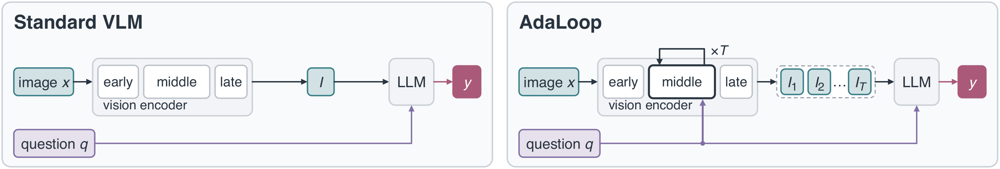
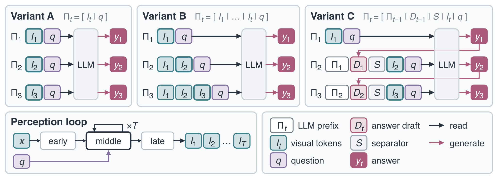
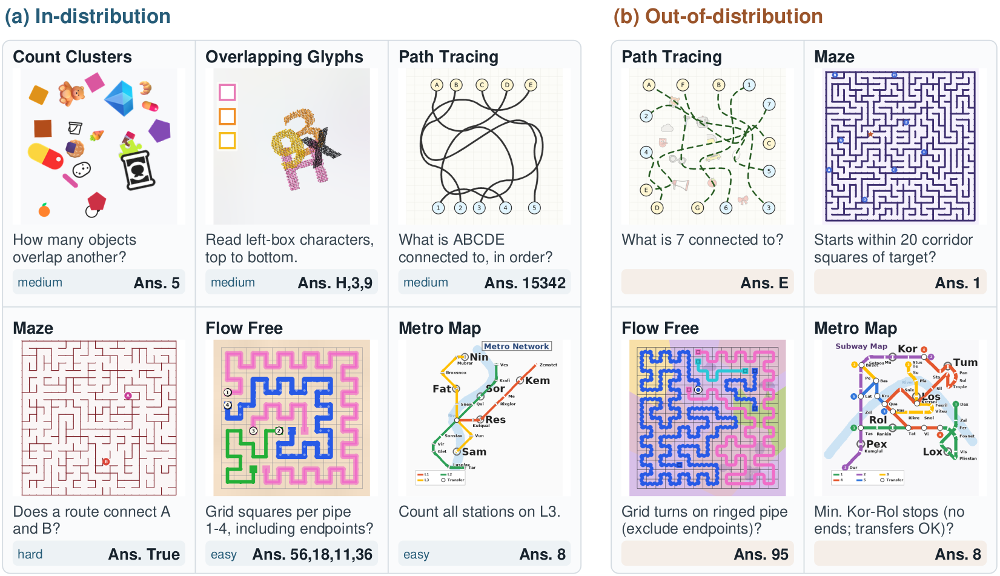

# AdaLoop: Thinking with the Vision Encoder

[](https://arxiv.org/abs/2610.21323)&nbsp;
[](https://huggingface.co/Lyy0725/AdaLoop)&nbsp;
[](https://huggingface.co/datasets/Lyy0725/VisRO)&nbsp;
[](LICENSE)&nbsp;

This is the official implementation for the paper [AdaLoop: Thinking with the Vision Encoder](https://arxiv.org/abs/2610.21323). It contains AdaLoop, with backends for Qwen2.5-VL-3B (PyTorch, GPUs), PaliGemma2-3B (JAX, TPUs or GPUs) and LLaVA-1.5-7B (PyTorch, GPUs). [VisRO](https://github.com/Lyy-iiis/VisRO), the procedural dataset and generation pipeline used for training and evaluation, lives in a separate repository.

## Overview

Most vision-language models treat the vision encoder as a static feature extractor: it encodes an image once, independently of the question, and leaves the reasoning to the language model. AdaLoop turns a span of the frozen vision encoder into a question-conditioned *perception loop*. The span is reused for several iterations, small AdaLN modules adapt each update to the question, and the language model answers from the resulting visual states. With matched training data and optimizer updates, AdaLoop outperforms standard fine-tuning and a question-conditioned single-pass baseline on three VLM families, both in distribution and out of distribution.

<p align="center">
  
</p>
<p align="left">
  <em><strong>Looking once versus repeatedly.</strong> Left: a standard VLM encodes the image once, independently of the question. Right: AdaLoop turns a span of the vision encoder into a question-conditioned perception loop that updates its visual state over T iterations; the language model answers from the resulting sequence.</em>
</p>

<p align="center">
  
</p>
<p align="left">
  <em><strong>Connecting visual iteration to language.</strong> Variant A answers from each visual state I<sub>t</sub> in isolation, Variant B from the whole history I<sub>1</sub> … I<sub>t</sub>, and Variant C interleaves each state with the previous answer draft. In all three, the answer can stop early once two consecutive answers agree (<code>p=1</code>).</em>
</p>

**VisRO** has 24 procedurally generated visual reasoning tasks in four categories, each at four training difficulty levels and a harder held-out level for out-of-distribution evaluation. The paper's experiments use six of them (VisRO-Core6). See the [VisRO documentation](https://github.com/Lyy-iiis/VisRO).

<p align="center">
  
</p>

## Repository Layout

| Path | Contents |
| --- | --- |
| [`adaloop/common/`](adaloop/common/README.md) | data loading and evaluation shared by the backends |
| [`adaloop/qwen/`](adaloop/qwen/README.md) | Qwen2.5-VL-3B-Instruct: SFT, AdaLN, Variants A/B/C |
| [`adaloop/paligemma/`](adaloop/paligemma/README.md) | PaliGemma2-3B-Mix-448: SFT, AdaLN, Variants A/B/C |
| [`adaloop/llava/`](adaloop/llava/README.md) | LLaVA-1.5-7B at 448 px: SFT, AdaLN, Variant A |
| [`adaloop/docs/`](adaloop/docs/) | architecture, the Variant A/B/C interfaces, the portable checkpoint format |

## Initialization

Run the commands from the repository root. Install the common package and one backend, using a separate environment for each backend because they pin different framework versions:

```bash
pip install -e ./adaloop/common -e './adaloop/qwen[gpu]'        # Qwen2.5-VL
pip install -e ./adaloop/common -e './adaloop/paligemma[runtime]' # PaliGemma 2
pip install -e ./adaloop/common -e './adaloop/llava[gpu]'       # LLaVA-1.5
```

The common package automatically installs the VisRO reader and scorer from a pinned source revision. They need only Python 3.10+ and Pillow. Each backend guide lists its tested Python and framework versions.

To generate new examples, follow the [VisRO generation guide](https://github.com/Lyy-iiis/VisRO#initialization) in a separate Python 3.12 environment.

## Data

Download VisRO from [Hugging Face](https://huggingface.co/datasets/Lyy0725/VisRO). The full dataset is 2,428,800 examples (about 89 GB) in 528 WebDataset tar shards; evaluation needs only the `eval` and `ood` shards:

```bash
# eval and ood splits of all 24 tasks
hf download Lyy0725/VisRO --repo-type dataset --local-dir data/VisRO --include "tasks/*/*/eval/*"
hf download Lyy0725/VisRO --repo-type dataset --local-dir data/VisRO --include "tasks/*/*/ood/*"

# everything, including the train split
hf download Lyy0725/VisRO --repo-type dataset --local-dir data/VisRO
```

All backends read the downloaded directory in place (`--visro-root data/VisRO`); `--tasks core6` (the default) selects the paper's six tasks. The paper's training runs also mix in 100,000 replay rows from LLaVA-NeXT, which are not part of VisRO; [`adaloop/README.md`](adaloop/README.md#data) describes how they were drawn and the JSONL format to supply your own.

## Inference

You can quickly verify your setup with our released checkpoints. Each one holds only the trained weights (LoRA and the AdaLoop modules) and is loaded on top of its base model. Scores are macro accuracy on VisRO-Core6 (3,600 items per split), as *measured from this checkpoint / reported in the paper*; Variants A, B and C use `p=1` stopping with at most 3 iterations.

<table><tbody>
<td valign="bottom">Qwen2.5-VL-3B</td>
<td valign="bottom" align="center">SFT</td>
<td valign="bottom" align="center">AdaLN</td>
<td valign="bottom" align="center">AdaLoop-A</td>
<td valign="bottom" align="center">AdaLoop-B</td>
<td valign="bottom" align="center">AdaLoop-C</td>
<tr><td align="left">checkpoint</td>
<td align="center"><a href="https://huggingface.co/Lyy0725/AdaLoop/tree/main/qwen/sft">qwen/sft</a></td>
<td align="center"><a href="https://huggingface.co/Lyy0725/AdaLoop/tree/main/qwen/adaln">qwen/adaln</a></td>
<td align="center"><a href="https://huggingface.co/Lyy0725/AdaLoop/tree/main/qwen/variant_a">qwen/variant_a</a></td>
<td align="center"><a href="https://huggingface.co/Lyy0725/AdaLoop/tree/main/qwen/variant_b">qwen/variant_b</a></td>
<td align="center"><a href="https://huggingface.co/Lyy0725/AdaLoop/tree/main/qwen/variant_c">qwen/variant_c</a></td>
</tr>
<tr><td align="left">ID (this checkpoint / paper)</td>
<td align="center">49.9 / 49.9</td>
<td align="center">59.9 / 60.0</td>
<td align="center">64.6 / 64.6</td>
<td align="center">62.1 / 62.1</td>
<td align="center">63.0 / 63.0</td>
</tr>
<tr><td align="left">OOD (this checkpoint / paper)</td>
<td align="center">23.6 / 23.9</td>
<td align="center">30.2 / 30.2</td>
<td align="center">32.5 / 32.4</td>
<td align="center">31.1 / 31.1</td>
<td align="center">32.0 / 32.0</td>
</tr>
</tbody></table>

<table><tbody>
<td valign="bottom">PaliGemma2-3B</td>
<td valign="bottom" align="center">SFT</td>
<td valign="bottom" align="center">AdaLN</td>
<td valign="bottom" align="center">AdaLoop-A</td>
<td valign="bottom" align="center">AdaLoop-B</td>
<td valign="bottom" align="center">AdaLoop-C</td>
<tr><td align="left">checkpoint</td>
<td align="center"><a href="https://huggingface.co/Lyy0725/AdaLoop/tree/main/paligemma/sft">paligemma/sft</a></td>
<td align="center"><a href="https://huggingface.co/Lyy0725/AdaLoop/tree/main/paligemma/adaln">paligemma/adaln</a></td>
<td align="center"><a href="https://huggingface.co/Lyy0725/AdaLoop/tree/main/paligemma/variant_a">paligemma/variant_a</a></td>
<td align="center"><a href="https://huggingface.co/Lyy0725/AdaLoop/tree/main/paligemma/variant_b">paligemma/variant_b</a></td>
<td align="center"><a href="https://huggingface.co/Lyy0725/AdaLoop/tree/main/paligemma/variant_c">paligemma/variant_c</a></td>
</tr>
<tr><td align="left">ID (this checkpoint / paper)</td>
<td align="center">62.7 / 62.6</td>
<td align="center">72.4 / 72.4</td>
<td align="center">75.2 / 75.2</td>
<td align="center">74.0 / –</td>
<td align="center">74.1 / –</td>
</tr>
<tr><td align="left">OOD (this checkpoint / paper)</td>
<td align="center">31.5 / 31.5</td>
<td align="center">40.0 / 40.0</td>
<td align="center">43.9 / 43.9</td>
<td align="center">43.7 / –</td>
<td align="center">41.1 / –</td>
</tr>
</tbody></table>

<table><tbody>
<td valign="bottom">LLaVA-1.5-7B</td>
<td valign="bottom" align="center">SFT</td>
<td valign="bottom" align="center">AdaLN</td>
<td valign="bottom" align="center">AdaLoop-A</td>
<td valign="bottom" align="center">AdaLoop-B</td>
<td valign="bottom" align="center">AdaLoop-C</td>
<tr><td align="left">checkpoint</td>
<td align="center"><a href="https://huggingface.co/Lyy0725/AdaLoop/tree/main/llava/sft">llava/sft</a></td>
<td align="center"><a href="https://huggingface.co/Lyy0725/AdaLoop/tree/main/llava/adaln">llava/adaln</a></td>
<td align="center"><a href="https://huggingface.co/Lyy0725/AdaLoop/tree/main/llava/variant_a">llava/variant_a</a></td>
<td align="center"><a href="https://huggingface.co/Lyy0725/AdaLoop/tree/main/llava/variant_b">llava/variant_b</a></td>
<td align="center"><a href="https://huggingface.co/Lyy0725/AdaLoop/tree/main/llava/variant_c">llava/variant_c</a></td>
</tr>
<tr><td align="left">ID (this checkpoint / paper)</td>
<td align="center">50.4 / 50.4</td>
<td align="center">57.7 / 57.7</td>
<td align="center">61.9 / 61.8</td>
<td align="center">59.3 / –</td>
<td align="center">60.0 / –</td>
</tr>
<tr><td align="left">OOD (this checkpoint / paper)</td>
<td align="center">24.8 / 24.8</td>
<td align="center">29.6 / 29.6</td>
<td align="center">31.2 / 31.1</td>
<td align="center">29.7 / –</td>
<td align="center">30.6 / –</td>
</tr>
</tbody></table>

Slight differences may arise from different hardware and numeric precision. The Qwen SFT checkpoint and the PaliGemma and LLaVA Variant B and C checkpoints were trained by us with the same recipes (the paper reports Variants B and C for Qwen only); all others are the paper's runs. The LLaVA checkpoints build on our stage-2 LLaVA-1.5-7B at 448 px, which is released alongside them as `llava/base/llava-v1.5-7b-448-s2`.

#### Sanity Check

1. **Download a checkpoint and the evaluation splits:**
    ```bash
    hf download Lyy0725/AdaLoop --include "qwen/variant_a/*" --local-dir checkpoints
    ```
    and the `eval` / `ood` shards as in [Data](#data).

2. **Launch evaluation:**
    ```bash
    adaloop-qwen-eval --checkpoint checkpoints/qwen/variant_a \
        --visro-root data/VisRO --tasks core6 --splits eval,ood \
        --output-dir outputs/eval/qwen_variant_a
    ```
    The base model `Qwen/Qwen2.5-VL-3B-Instruct` is fetched from the Hugging Face Hub at the revision pinned in the checkpoint. The evaluator answers every item at depths 1–3, applies `p=1` stopping, and writes per-item predictions, `summary.json` and a per-task table `results.md`. The expected scores are about 64.6 (ID) and 32.5 (OOD). `--per-cell 10` gives a quick check on 10 items per task and difficulty.

PaliGemma evaluation (`adaloop-paligemma-eval`) additionally takes the gated base weights and tokenizer, and LLaVA evaluation (`adaloop-llava-eval`) a configuration file with the base and CLIP paths; see the [PaliGemma](adaloop/paligemma/README.md#evaluation) and [LLaVA](adaloop/llava/README.md#evaluation) guides. To answer a single image and question, use `adaloop-qwen-infer`, `adaloop-paligemma-infer` or `adaloop-llava-infer` with `--depth T` or `--p1`.

## Training

Each backend trains from a recipe in its `configs/` directory: `sft.yaml`, `adaln.yaml`, `variant_a.yaml`, and for Qwen and PaliGemma also `variant_b.yaml` and `variant_c.yaml`. A recipe fixes the model, the loop span and depth, the loss and the optimizer; the command line supplies the paths. For example, Variant A on Qwen with 4 GPUs:

```bash
accelerate launch --num_processes 4 --mixed_precision bf16 \
    -m adaloop_qwen.cli.train \
    --config adaloop/qwen/configs/variant_a.yaml \
    --visro-root data/VisRO --tasks core6 \
    --replay-jsonl /path/to/replay.jsonl \
    --output-dir outputs/qwen_variant_a \
    --per-device-batch-size 1 --gradient-checkpointing
```

on PaliGemma, with all visible TPU or GPU devices:

```bash
adaloop-paligemma-train \
    --config adaloop/paligemma/configs/variant_a.yaml \
    --base-checkpoint /path/to/paligemma2-3b-mix-448.b16.npz \
    --tokenizer /path/to/tokenizer.model \
    --visro-root data/VisRO --replay-jsonl /path/to/replay.jsonl \
    --output-dir outputs/paligemma_variant_a \
    --export-dir outputs/paligemma_variant_a/release
```

and on LLaVA, with 8 GPUs:

```bash
torchrun --standalone --nproc_per_node 8 -m adaloop_llava.cli.train \
    --config adaloop/llava/configs/variant_a.yaml \
    --base-model /path/to/llava-v1.5-7b-448-s2 \
    --vision-tower /path/to/clip-vit-large-patch14-336 \
    --visro-root data/VisRO --replay-jsonl /path/to/replay.jsonl \
    --output-dir outputs/llava_variant_a
```

The paper trains Qwen and LLaVA for 40,000 steps and PaliGemma for 30,000 steps at a global batch size of 64. Every backend can resume from its latest checkpoint and exports a portable checkpoint at the end. See the backend guides for every recipe, smaller-GPU settings, resuming and checkpoint conversion, and [`adaloop/README.md`](adaloop/README.md) for the shared data and evaluation contracts.

## License

The code is under the Apache License 2.0, see [LICENSE](LICENSE). [NOTICE](NOTICE) lists the code adapted from other projects and attribution for the VisRO example figure. The VisRO repository has its own [NOTICE](https://github.com/Lyy-iiis/VisRO/blob/main/NOTICE) for its bundled icons and fonts. The VisRO dataset is under CC BY-SA 4.0. The checkpoints are derived from Qwen2.5-VL, PaliGemma 2 and LLaVA-1.5 and are subject to the terms of those base models.

## Citation

If you find this work useful in your research, please consider citing our paper :)

```bib
@article{adaloop2026,
  title={AdaLoop: Thinking with the Vision Encoder},
  author={Han, Xinran Nicole and Lu, Yiyang and Gan, Katelyn and Zickler, Todd},
  journal={arXiv preprint arXiv:2610.21323},
  year={2026}
}
```

## Acknowledgement

We thank Kaiming He for insightful discussions on the AdaLoop framework and Jianbo Shi for proofreading the manuscript. We also thank Keya Hu and Qiao Sun for helpful discussions on TPU infrastructure. We gratefully acknowledge the Google TPU Research Cloud (TRC) for granting TPU access. Many VisRO tasks are procedural counterparts of task types in the BabyVision benchmark (Chen et al., ICML 2026); see the [VisRO acknowledgements](https://github.com/Lyy-iiis/VisRO#acknowledgements).
